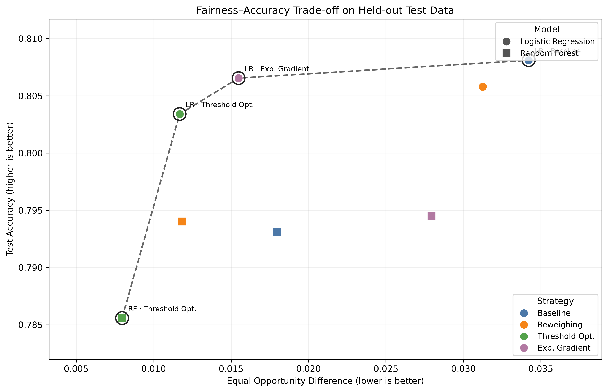
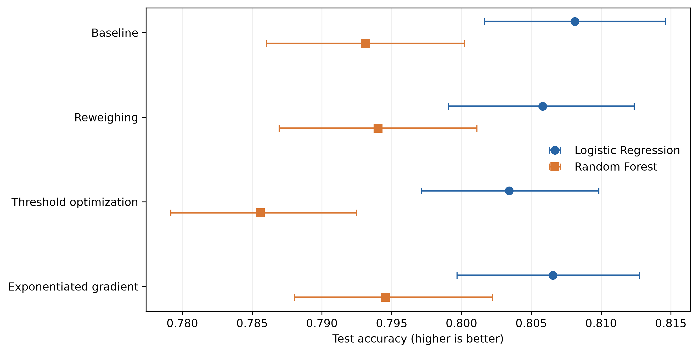

# Fairness–Accuracy Trade-offs in Machine Learning

**An empirical comparison of bias mitigation strategies on ACSIncome**

## Overview

This project investigates how fairness interventions affect predictive performance and group disparities in binary income classification. Using the ACSIncome task from the American Community Survey, it compares two classifiers and three bias mitigation strategies against their unmitigated baselines.

The central research question is:

**To what extent can group fairness disparities be reduced without substantially compromising predictive accuracy?**

The study evaluates both predictive performance and fairness outcomes, emphasizing that improvements in one fairness metric do not necessarily translate into improvements across all metrics.

## Dataset

The experiments use the **ACSIncome** task provided by [Folktables](https://github.com/socialfoundations/folktables), based on the 2018 American Community Survey (ACS) 1-Year Public Use Microdata Sample for Illinois.

| Property | Description |
|---|---|
| Task | Binary income classification |
| Target | Annual income above $50,000 |
| Observations | 67,016 after ACSIncome preprocessing |
| Predictive features | 9 |
| Protected attribute | `SEX` |
| Training set | 40,209 observations (60%) |
| Validation set | 13,403 observations (20%) |
| Test set | 13,404 observations (20%) |
| Random seed | 42 |

The protected attribute is excluded from the predictive features but retained for group-level fairness evaluation and for mitigation methods that require group information.

Additional dataset documentation is available in [`docs/dataset_notes.md`](docs/dataset_notes.md).

## Experimental Design

### Classifiers

Two supervised learning models are evaluated:

- **Logistic Regression**, with standardized numerical features and one-hot encoded categorical features.
- **Random Forest**, using the same preprocessing pipeline.

### Bias Mitigation Strategies

| Strategy | Approach |
|---|---|
| Baseline | Training without a fairness intervention |
| Reweighing | Adjusting training sample weights based on group and target-label frequencies |
| Threshold Optimization | Applying group-specific decision thresholds to model predictions |
| Exponentiated Gradient | Training under a fairness constraint using a reduction-based optimization method |

The experiments use the training and validation sets for model fitting and mitigation. The held-out test set is reserved for final evaluation.

### Evaluation Metrics

**Predictive performance**
- Accuracy
- Balanced Accuracy

**Group fairness**
- Equal Opportunity Difference (EOD): absolute difference in true positive rates
- Demographic Parity Difference (DPD): absolute difference in positive prediction rates
- False Positive Rate Gap: absolute difference in false positive rates

The study also uses bootstrap confidence intervals to characterize uncertainty and Pareto analysis to examine trade-offs between Accuracy and EOD.

## Results

### Held-out Test Performance

| Model | Strategy | Accuracy | Balanced Accuracy | EOD | DPD | FPR Gap |
|---|---|---:|---:|---:|---:|---:|
| Logistic Regression | Baseline | 0.8081 | 0.7938 | 0.0342 | 0.1385 | 0.0506 |
| Logistic Regression | Reweighing | 0.8058 | 0.7911 | 0.0312 | 0.0906 | 0.0128 |
| Logistic Regression | Threshold Optimization | 0.8034 | 0.8013 | 0.0117 | 0.1274 | 0.0420 |
| Logistic Regression | Exponentiated Gradient | 0.8066 | 0.7923 | 0.0155 | 0.1245 | 0.0398 |
| Random Forest | Baseline | 0.7931 | 0.7754 | 0.0180 | 0.1221 | 0.0434 |
| Random Forest | Reweighing | 0.7940 | 0.7758 | 0.0118 | 0.1019 | 0.0280 |
| Random Forest | Threshold Optimization | 0.7856 | 0.7896 | 0.0080 | 0.1054 | 0.0238 |
| Random Forest | Exponentiated Gradient | 0.7945 | 0.7766 | 0.0279 | 0.1262 | 0.0434 |

Higher Accuracy and Balanced Accuracy are preferable; lower absolute fairness gaps indicate smaller observed disparities.

### Main Findings

**Threshold Optimization substantially reduced EOD for both classifiers.** For Logistic Regression, EOD decreased from 0.0342 to 0.0117, while Accuracy declined from 0.8081 to 0.8034.

**Exponentiated Gradient provided a favorable Accuracy–EOD trade-off for Logistic Regression.** Accuracy remained at 0.8066 while EOD decreased to 0.0155. The same strategy did not improve EOD for Random Forest.

**Reweighing had different effects across fairness metrics.** For Logistic Regression, it reduced DPD and the FPR Gap more substantially than EOD.

These findings suggest that the effectiveness of bias mitigation depends on the classifier, the intervention, and the fairness criterion being evaluated.

### Visualizations

**Accuracy–fairness Pareto frontier**



**Predictive accuracy comparison**



**Additional visualizations**

- [Equal opportunity difference comparison](results/eod_comparison.png)
- [Secondary fairness metrics comparison](results/secondary_metrics_comparison.png)

## Repository Structure

```text
fairness-accuracy-tradeoffs/
├── docs/
│   └── dataset_notes.md
├── notebooks/
│   ├── 01_eda.ipynb
│   ├── 02_baseline.ipynb
│   ├── 03_reweighing.ipynb
│   ├── 04_threshold_optimization.ipynb
│   ├── 05_exponentiated_gradient.ipynb
│   ├── 06_final_evaluation.ipynb
│   ├── 07_pareto_frontier.ipynb
│   └── 08_results_visualization.ipynb
├── results/
├── src/
│   ├── data.py
│   ├── experiment.py
│   └── models.py
├── .gitignore
├── requirements.txt
└── README.md
```

The notebooks follow the experimental workflow from exploratory data analysis through validation experiments, held-out test evaluation, and visualization.

## Reproducibility

The project uses Python, Folktables, scikit-learn, Fairlearn, pandas, NumPy, and Matplotlib.

### 1. Clone the repository

```bash
git clone <repository-url>
cd fairness-accuracy-tradeoffs
```

### 2. Create a virtual environment

```bash
python -m venv .venv
source .venv/bin/activate
```

### 3. Install dependencies

```bash
python -m pip install -r requirements.txt
```

### 4. Run the notebooks

Open the `notebooks/` directory in VS Code or Jupyter and execute the notebooks in numerical order, from `01_eda.ipynb` through `08_results_visualization.ipynb`.

The ACS data are downloaded automatically through Folktables and stored locally in the ignored `data/` directory. Generated tables and figures are saved to `results/`.

The experiments use a fixed random seed of 42 for the data split and model initialization. Bootstrap-based estimates may depend on their respective random-state settings.


### Practical Implications

The results suggest that mitigation strategies should be selected according to the relative importance of predictive performance and fairness objectives.

For applications where equal opportunity is a priority, Threshold Optimization offers a promising trade-off. In the Logistic Regression experiments, it reduced the equal opportunity difference from 0.0342 to 0.0117, while accuracy decreased only slightly from 0.8081 to 0.8034.

When preserving predictive accuracy is particularly important, Exponentiated Gradient may offer an alternative: for Logistic Regression, it reduced the equal opportunity difference to 0.0155 while maintaining accuracy at 0.8066.

However, no single strategy performed best across all models and fairness metrics. In practice, organizations should choose mitigation methods based on the specific application, the costs of different prediction errors, relevant fairness requirements, and validation on representative deployment data. The results should not be interpreted as direct recommendations for credit lending, hiring, or other high-stakes decisions.


## Limitations

Group fairness metrics summarize differences in observed model outcomes. They do not independently establish discriminatory causation or resolve normative questions about which fairness criterion should be prioritized.

The Accuracy–EOD Pareto frontier is descriptive of the evaluated configurations and does not imply statistical separation between nearby points.

The findings are based on ACSIncome data from Illinois in 2018 and may not generalize to other states, time periods, populations, or real-world decision-making contexts. Further evaluation across multiple datasets and deployment settings is necessary before drawing broader conclusions.

## Research Log
For a detailed retrospective on the methodological decisions, intermediate findings, and refactoring process, see [Research Log](docs/research_log.md).

## References

- Ding, F., Hardt, M., Miller, J., & Schmidt, L. (2021). *Retiring Adult: New Datasets for Fair Machine Learning*. NeurIPS.
- Bird, S., et al. (2020). *Fairlearn: A Toolkit for Assessing and Improving Fairness in AI*. Microsoft Research.
- U.S. Census Bureau. *American Community Survey Public Use Microdata Sample (PUMS)*.